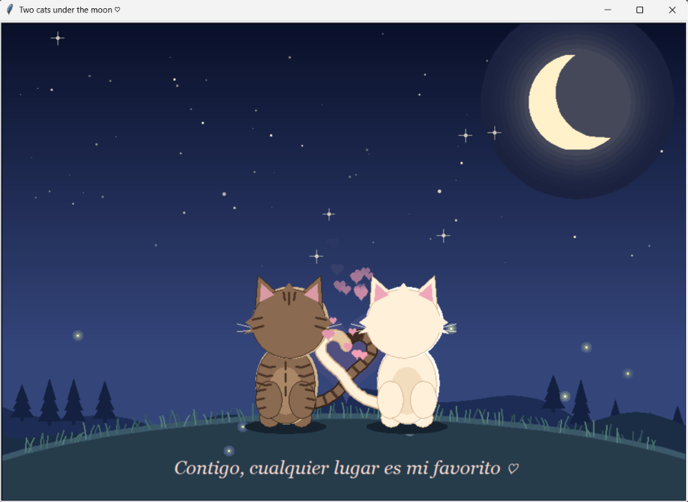

# 🐈 Two Cats Under the Moon 🌙

Two little cats, one beautiful night, and a heart made of love.

This project is a romantic animation created with **Python Turtle**, featuring two adorable cats sitting together under a glowing crescent moon.

As the animation unfolds, the two little cats approach each other until their tails gently come together, forming a heart. Surrounded by twinkling stars, a shooting star, and glowing fireflies, the scene becomes a little reminder that love makes every place feel like home.

## ✨ Features

- 🐈 **Two Animated Cats:** A tabby cat and a cream-colored cat walking toward each other.
- 🌙 **Crescent Moon:** A glowing moon illuminating the nighttime landscape.
- 💗 **Heart-Shaped Tails:** The cats' tails gradually transform into a beautiful heart.
- ⭐ **Twinkling Stars:** Animated stars with soft glowing effects.
- ☄️ **Shooting Star:** An occasional shooting star crossing the night sky.
- ✨ **Fireflies:** Tiny glowing lights floating around the landscape.
- 💕 **Floating Hearts:** Little hearts appearing once the cats form their heart shape.
- 💌 **Romantic Message:** A special message revealed at the end of the animation.

## 🎨 Graphical Representation

### The final result

<!-- Replace the filenames below with your actual assets -->
<p align="left">
  
</p>

### 🎬 Animation preview

Watch the script bring the two cats under the moon to life:

<p align="center">
  <a href="graphical-representation/cats.mp4">▶ Watch the animation</a>
</p>

## 🛠️ Technologies Used

- Python 3
- Turtle Graphics
- Math
- Random

## 🚀 How to Run

1. Make sure Python 3 is installed on your computer.
2. Clone this repository:

   ```bash
   git clone https://github.com/laetg404/two-cats-under-the-moon.git
   ```

3. Navigate to the project directory:

   ```bash
   cd two-cats-under-the-moon
   ```

4. Run the Python script:

   ```bash
   python main.py
   ```

The animation window will open automatically.

## 📁 Project Structure

```text
two-cats-under-the-moon/
│
├── graphical-representation/
│   ├── preview.png
│   └── animation.mp4
│
├── main.py
└── README.md
```

## ♡ Just Like Being Home

My love,

I think one of the loveliest things about love is knowing that, no matter how far apart two little hearts might be, they can always find their way to each other.

I made these two little cats thinking about us. Two different little souls, walking through their own paths, until they find each other beneath the same moon.

And when they finally do, their tails come together to form a heart, because even the smallest parts of them seem to know where they belong.

I hope you always remember that, wherever life takes us, being with you will always be my favorite place to be.

**With you, any place is my favorite. ♡**
